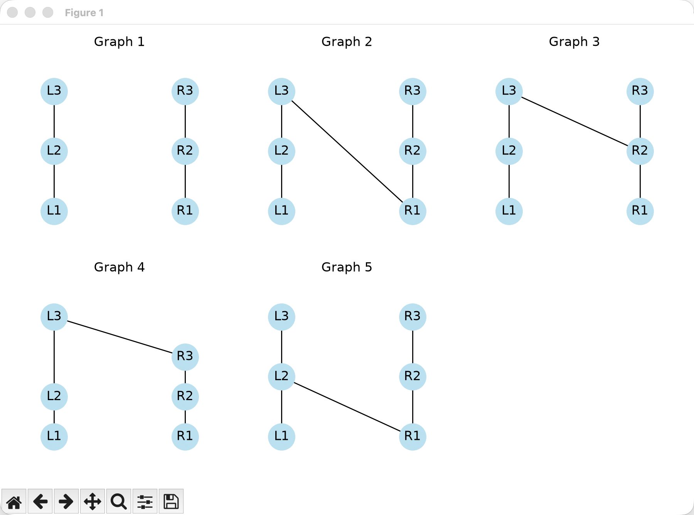

# Two-Chain Generator

I wrote this Python program for my 2025 master’s thesis in Applied
Mathematics at the University of Southern California. It generates and
visualizes examples of 2-chains, a class of partially ordered sets, as
part of my research on order polynomials.

## How it works

The generator starts with a three-vertex base case. To build the next
size, it extends each graph by adding a vertex to either the left or
the right chain and updating the edges according to the construction
in the thesis. It uses NetworkX to represent the graphs and Matplotlib
to draw them. Isomorphic cases may appear in the output.

## Run the demo

From the repository folder, with Python 3 installed, run:

```bash
python3 -m venv .venv
source .venv/bin/activate
python -m pip install networkx matplotlib
python generate_two_chains.py
```

The script opens a window with two four-vertex graph drawings, one
for each extension of the base case.

## Thesis reference

The original Python listing appears in Appendix A of my USC master’s
thesis. This repository includes a runnable version of that listing.

## Example output

The first five Hasse diagrams for two labeled chains of three vertices each.




## Usage

From the repository folder, install the dependencies and run the generator:

```bash
python3 -m pip install networkx matplotlib
python3 2-chain.py
```

The script draws the first five Hasse diagrams and saves them as
`first-five-2-chains.png`.
